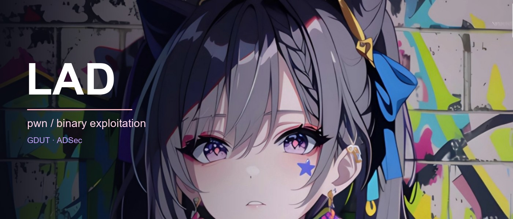

<div align="center">



<a href="https://laiandi.github.io"></a>
<a href="https://github.com/LAIANDI/ctf-writeups"></a>


<br/><br/>


<br/><br/>


</div>

```console
lad@github:~$ neofetch
       .--.
      |o_o |    LAD / LAIANDI
      |:_/ |    GDUT · AD 攻防工作室
     //   \ \   pwn / glibc heap / CTF
    (|     | )  nice to meet you
   /'\_   _/`\
   \___)=(___/
```

## 🌸 关于我

|  |  |
|:--|:--|
| **名字** | LAD / LAIANDI |
| **所属** | 广东工业大学 · AD 攻防工作室 |
| **方向** | Linux userland exploitation · glibc heap · CTF pwn |
| **偏好** | House of Apple 2 · House of Some · seccomp ORW |

## 🍡 精选

| 题目 | 赛事 | 考点 |
|:--|:--|:--|
| [glibc_master](https://github.com/LAIANDI/ctf-writeups/blob/main/pwn/glibc_master.md) | 长城杯 2022 | 堆 UAF · 负下标 OOB · House of Apple 2 FSOP |
| [superheap](https://github.com/LAIANDI/ctf-writeups/blob/main/pwn/superheap.md) | CISCN 2024 | Go + protobuf · tcache poisoning · House of Some · ORW |
| [msgboard](https://github.com/LAIANDI/ctf-writeups/blob/main/pwn/msgboard.md) | DASCTF | 格式化字符串 · `leave;ret` 栈迁移 · seccomp ORW |
| [minihttpd](https://github.com/LAIANDI/ctf-writeups/blob/main/pwn/minihttpd.md) | CISCN 2025 Quals | 非 PIE 栈溢出 · 无 pop rdx · 任意文件读 |

→ 更多见 [**ctf-writeups**](https://github.com/LAIANDI/ctf-writeups)

## 🎀 出题

**ADCTF 2026 · pwn**：6 道题，难度曲线 `ret2win → shellcode → fmt → pivot → ORW → heap`。

## ✨ 工具箱

<p>


</p>

## 🌙 现在

- 🔭 在做：把零散题解整理成可复现的作品集
- 🌱 在学：真实漏洞（CVE）复现、Linux 内核基础
- 💬 兴趣：heap feng shui、`io_uring`、KVM

## 💌 链接

[Blog](https://laiandi.github.io) · [GitHub](https://github.com/LAIANDI)

<div align="center">

`可爱即正义，heap 也是。`

<sub>只在本机隔离环境和授权目标上做安全研究。</sub>

</div>
